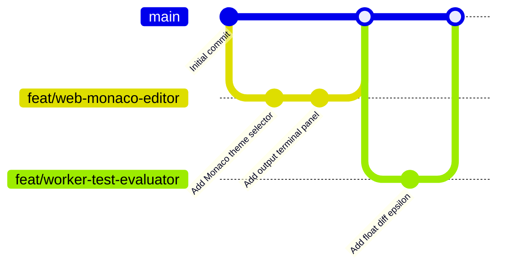

# 🚀 AI Code Evolution Lab — Team Collaboration & Workflow Guide

> **Welcome Team!** This guide defines our complete day-to-day development workflow, role distribution, Git conventions, and local testing instructions for building **AI Code Evolution Lab** smoothly as a 4-member hackathon team.

---

## 👥 1. Team Role & Code Ownership Matrix

To prevent merge conflicts and ensure everyone moves at full speed, our repository is architected as an isolated **Turborepo Monorepo** where each developer owns dedicated modules:

| Role | Developer | Dedicated Codebase Directory | Core Responsibilities |
| :--- | :--- | :--- | :--- |
| **Full-Stack Lead & DB Architect** | **Developer 1 (Lead)** | `apps/api/`<br>`packages/shared/` | Express REST Gateway, Auth/JWT, PostgreSQL & MongoDB schemas, Render/Vercel deployments. |
| **Frontend UI/UX Specialist** | **Developer 2** | `apps/web/` | React 18, Tailwind CSS, Monaco Editor workspace, SSE real-time hook, interactive comparison and report dashboards. |
| **Execution Engine Specialist** | **Developer 3** | `apps/worker/` | BullMQ worker, Judge0 CE execution sandbox, deterministic test case diffing, logarithmic scoring engine. |
| **AI & Analytics Specialist** | **Developer 4** | `packages/ai-engine/` | Google Gemini 1.5 Flash client, Mode A (Optimization) & Mode B (Diagnostic) prompt engineering, Zod schema validation. |

---

## 💻 2. One-Time Setup for Every Teammate

Every teammate must run these steps once on their computer (Ubuntu, macOS, or Windows WSL2):

### Prerequisites
- **Node.js**: `v20.x` or higher (`node -v`)
- **pnpm**: `v10.x` or `v12.x` (`npm install -g pnpm`)
- **Git**: Installed and configured (`git --version`)

### Step-by-Step Clone & Setup:

```bash
# 1. Clone the repository
git clone https://github.com/mohankunjam25-hue/AiCA.git
cd AiCA

# 2. Install all dependencies across the entire monorepo
pnpm install

# 3. Create your local environment configuration file
cp .env.example .env

# 4. Build all packages to ensure types are compiled
pnpm build

# 5. Run test suite to verify everything passes
pnpm test
```

> [!TIP]
> **For Frontend Developers:** You can either point your local frontend to the **Live Render Backend** (`VITE_API_URL=https://aicabackend.onrender.com`) in `apps/web/.env` or run the local API (`http://localhost:5000`).

---

## ⚡ 3. Daily Development: How to Run Your Work

Instead of running everything if you don't need to, you can run only the specific parts you are working on:

### Option A: Run Only Your Specific Module (Recommended for Speed)

| If you are working on... | Run this command | What it starts |
| :--- | :--- | :--- |
| **Frontend UI (`apps/web`)** | `pnpm --filter @aica/web dev` | Vite Dev Server at **`http://localhost:5173`** (Fast Hot-Reload) |
| **Backend API (`apps/api`)** | `pnpm --filter @aica/api dev` | Express API Gateway at **`http://localhost:5000`** (Auto-restart with TSX) |
| **Worker (`apps/worker`)** | `pnpm --filter @aica/worker dev` | BullMQ execution daemon |
| **AI Engine Tests** | `pnpm test` | Vitest testing Gemini parser & scoring engine |

### Option B: Run the Entire System Together
To run both the Frontend and Backend API concurrently:
```bash
pnpm dev
```

---

## 🌿 4. Git Collaboration Workflow (Zero-Conflict Rules)

To ensure no one ever accidentally overwrites another person's code, follow this strict Git workflow:



### Rule 1: Never Code Directly on `main`
Always create a new feature branch before writing code:

```bash
# Update your main branch first
git checkout main
git pull origin main

# Create and switch to your feature branch
# Naming format: feat/<module>-<description> or fix/<module>-<description>
git checkout -b feat/web-leaderboard-filter     # For Frontend Dev
git checkout -b feat/worker-memory-profiling   # For Worker Dev
git checkout -b feat/ai-diagnostic-prompts     # For AI Dev
```

### Rule 2: Commit Often with Clear Messages
Follow Conventional Commits:
```bash
git add .
git commit -m "feat(web): added sorting by runtime in leaderboard"
# Or:
git commit -m "fix(worker): handle NaN in test execution time"
```

### Rule 3: Sync with Latest `main` Before Pushing
Before pushing to GitHub, always pull any new changes that other teammates merged:
```bash
git checkout main
git pull origin main
git checkout your-feature-branch
git merge main
```

### Rule 4: Push Branch and Create a Pull Request (PR)
```bash
# Push your branch to GitHub
git push -u origin your-feature-branch
```
1. Open the repo on GitHub: `https://github.com/mohankunjam25-hue/AiCA`
2. Click **"Compare & pull request"**.
3. Team Lead reviews and clicks **"Merge pull request"**.
4. Once merged, Render and Vercel will automatically redeploy!

---

## 🔍 5. How to View a Teammate's UI / Code Locally

### Scenario A: A teammate merged changes into `main` and you want to see it
To view the latest updates that someone else pushed:
```bash
# 1. Switch to main
git checkout main

# 2. Pull the latest changes from GitHub
git pull origin main

# 3. If they added any new packages, install them
pnpm install

# 4. Start the frontend
pnpm --filter @aica/web dev
```
Open **`http://localhost:5173`** in your browser. All your teammate's new UI changes are now live on your machine!

---

### Scenario B: You want to test a teammate's branch *before* it is merged into `main`
If a teammate pushed `feat/web-custom-theme` and asked you to review it:
```bash
# Fetch all branches from GitHub
git fetch origin

# Switch to their branch
git checkout feat/web-custom-theme

# Run the frontend to test their work
pnpm --filter @aica/web dev
```
When you are done testing, simply return to your own branch:
```bash
git checkout main
```

---

## 🧩 6. Working with Shared Types (`packages/shared`)

All shared types (e.g. `User`, `Problem`, `Submission`, `EvaluationReport`) live inside `packages/shared`.

Whenever anyone modifies a type or schema in `packages/shared`:
1. Edit the file in `packages/shared/src/`.
2. **Rebuild the shared package immediately**:
   ```bash
   pnpm --filter @aica/shared build
   ```
3. All other packages (`apps/web`, `apps/api`, `apps/worker`) will immediately recognize the new types!

---

## 🛠️ 7. Troubleshooting & Common Fixes

| Issue / Error | Cause | Quick 10-Second Fix |
| :--- | :--- | :--- |
| `Cannot find module '@aica/shared'` | Shared package has not been built on your machine | Run `pnpm --filter @aica/shared build` |
| `Port 5173 is already in use` | An old Vite instance is running in the background | Run `npx kill-port 5173` |
| `Port 5000 is already in use` | An old Express instance is running in the background | Run `npx kill-port 5000` |
| `Git Merge Conflict` | Two teammates edited the exact same line in the same file | Open VS Code, accept current or incoming change, save, then `git commit` |
| New dependencies not found | A teammate installed a new library and you pulled their code | Run `pnpm install` |

---

## 📞 8. Quick Communication Checklist
- **Before starting a new feature:** Tell the team in WhatsApp/Discord/Slack which file or feature you are starting.
- **Before editing `packages/shared`:** Notify the team because this affects both Frontend and Backend.
- **After PR is merged:** Tell teammates: *"Latest code merged into main, please run `git pull origin main && pnpm install`"*.

Happy Coding! 🚀 Let's win this hackathon!
